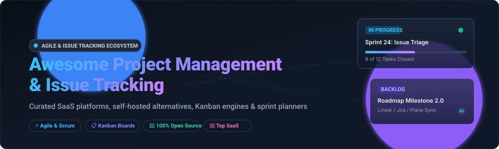

  

# Awesome Project Management & Issue Tracking 🚀

  
  
  
  
  
  

> 🎯 **Curated directory of top-tier SaaS platforms and high-performance open-source GitHub projects for modern Project Management, Issue Tracking, Agile Sprints, Kanban Boards, Product Roadmaps, and Collaborative Engineering Workspaces.**

---

## 📑 Table of Contents
- [Sector Overview & Market Dynamics](#-sector-overview--market-dynamics)
- [SaaS / Hosted Platforms](#-saashosted-platforms)
- [Open-Source GitHub Projects](#-open-source-github-projects)
- [Star History](#-star-history)
- [How to Contribute](#-how-to-contribute)
- [Support & Community](#-support--community)
- [Disclaimer](#-disclaimer)

---

## 🌐 Sector Overview & Market Dynamics

The global project management and collaborative work management (CWM) software market is estimated at **$7.5 billion in 2024–2025** and is projected to expand beyond **$15 billion by 2030** at a compound annual growth rate (CAGR) of ~10.7% to 13.5%. The market is **moderately fragmented**; while enterprise incumbent ecosystems like Atlassian (Jira) and public Work OS leaders (Monday.com, Asana) dominate large organizational deployments, developer-centric disruptors (Linear, Shortcut) and high-growth open-source self-hosted alternatives (Plane, Huly, OpenProject) prevent winner-take-all consolidation by capturing engineering-first, privacy-focused, and self-hosted workflows.

---

## 🏢 SaaS/Hosted Platforms

The following table summarizes industry-leading hosted project management and issue tracking platforms, sorted in descending order by company scale (market capitalization, annual recurring revenue, or private valuation):

| Platform | Valuation / Scale | Starting Pricing | Free Tier Limit | Highlights & Best For |
| :--- | :--- | :--- | :--- | :--- |
| **[Atlassian Jira](https://atlassian.com)** | **~$45B - $50B** (Market Cap) | $7.75 / user / month *(Standard)* | Free forever for up to 10 users, 2 GB file storage, unlimited boards | The enterprise gold standard for Scrum, Kanban, agile roadmaps, and deep DevOps CI/CD integrations. |
| **[Monday.com](https://monday.com)** | **~$12B - $14B** (Market Cap) | $9.00 / seat / month *(Basic, min 3 seats)* | Free forever for up to 2 seats, 3 boards, 200+ templates, 500 MB storage | Highly customizable Work OS featuring visual boards, Gantt charts, automations, and cross-team workflows. |
| **[Asana](https://asana.com)** | **~$3B - $4B** (Market Cap) | $10.99 / user / month *(Starter)* | Free forever for up to 10 teammates, unlimited tasks, projects, messages, and activity log | Intuitive cross-functional work management platform for company goals, timeline tracking, and team dependencies. |
| **[ClickUp](https://clickup.com)** | **~$4B** (Private Valuation) | $7.00 / user / month *(Unlimited)* | Free forever with 100 MB storage, unlimited tasks, unlimited members, and 60 uses of custom fields | Feature-dense "one app to replace them all" combining docs, whiteboards, sprint planning, and time tracking. |
| **[Planview](https://planview.com)** | **~$1.6B+** (TPG / Private Equity) | Custom quote based on seats (est. ~$20 - $30 / user / month) | 30-day guided enterprise free trial with full portfolio management capabilities | Enterprise portfolio management (PPM) and value stream delivery platform for complex digital transformations. |
| **[Linear](https://linear.app)** | **~$400M - $500M** (Series B Valuation) | $8.00 / user / month *(Standard)* | Free forever for unlimited members, up to 250 active issues, and 10 MB file uploads | High-speed, keyboard-first issue tracker and product planning platform engineered specifically for modern software teams. |
| **[Basecamp (37signals)](https://basecamp.com)** | **~$100M+** (Est. ARR / Private) | $15.00 / user / month *(or $299/mo unlimited users)* | 30-day unlimited free trial (no credit card required; free 1-project plan for students/personal use) | Opinionated, calm remote team communication and project hub built around message boards, to-dos, and Hill Charts. |
| **[Shortcut](https://shortcut.com)** | **~$100M+** (Venture Backed) | $8.50 / user / month *(Team)* | Free forever for up to 4 users with unlimited teams, roadmaps, and full VCS integrations | Developer-friendly agile project tracker uniting engineering sprint planning directly with Git pull requests and stories. |
| **[Wrike (Symphony Technology)](https://wrike.com)** | **~$800M+** (Private Equity Acquisition) | $9.80 / user / month *(Team)* | Free forever for unlimited users with basic task management, active task limits, and 2 GB storage | Robust enterprise work management suite featuring Gantt charts, interactive proofing, and workload balancing. |
| **[Pivotal Tracker (Broadcom)](https://pivotaltracker.com)** | **Legacy / Broadcom Division** | $10.00 / month *(5 collaborators)* | Free forever for up to 5 collaborators and 5 projects with 200 MB storage | Agile pioneer famed for automated velocity calculation, story point estimation, and lightweight backlog triage. |

---

## 💻 Open-Source GitHub Projects

Curated self-hosted project managers, issue trackers, and Kanban boards. Each repository includes a real-time star badge linked directly to its GitHub stargazers page, sorted in descending order by GitHub stars:

- **[AppFlowy-IO/AppFlowy](https://github.com/AppFlowy-IO/AppFlowy)**   
  *Open-source Notion and ClickUp alternative built with Flutter and Rust, featuring visual Kanban boards, relational databases, offline-first notes, and team task views.*

- **[toeverything/AFFiNE](https://github.com/toeverything/AFFiNE)**   
  *All-in-one workspace uniting structured task databases, visual whiteboards, and multimodal planning documents into an open-source project management canvas.*

- **[nocodb/nocodb](https://github.com/nocodb/nocodb)**   
  *Open-source Airtable alternative transforming any MySQL, PostgreSQL, or SQLite database into an agile smart spreadsheet with Kanban, Grid, and Form views.*

- **[makeplane/plane](https://github.com/makeplane/plane)**   
  *Modern open-source software development tracker and Linear/Jira alternative featuring sprint Cycles, Modules, Pages, Kanban boards, and GitHub sync.*

- **[twentyhq/twenty](https://github.com/twentyhq/twenty)**   
  *Modern open-source CRM and collaborative project pipeline engine providing full data ownership, visual deal boards, task workflows, and rich API extensions.*

- **[go-gitea/gitea](https://github.com/go-gitea/gitea)**   
  *Painless, lightweight self-hosted Git service written in Go with built-in issue tracking, milestones, labels, and customizable Kanban project boards.*

- **[BloopAI/vibe-kanban](https://github.com/BloopAI/vibe-kanban)**   
  *AI-native developer Kanban workspace designed to coordinate autonomous coding agents, triage issue backlogs, and streamline engineering tasks.*

- **[hcengineering/platform (Huly)](https://github.com/hcengineering/platform)**   
  *All-in-one open-source workspace and Linear/Slack alternative combining lightning-fast issue tracking, virtual office spaces, project roadmaps, and chat.*

- **[mattermost-community/focalboard](https://github.com/mattermost-community/focalboard)**   
  *Open-source multilingual project management alternative to Trello, Notion, and Asana with Kanban, table, and gallery views for teams.*

- **[wekan/wekan](https://github.com/wekan/wekan)**   
  *The open-source collaborative Kanban board application built on Meteor, supporting swimlanes, subtasks, checklists, card templates, and LDAP/OAuth.*

- **[opf/openproject](https://github.com/opf/openproject)**   
  *Comprehensive enterprise open-source project management platform supporting classic Gantt charts, agile Scrum/Kanban boards, roadmaps, and cost estimation.*

- **[theonedev/onedev](https://github.com/theonedev/onedev)**   
  *Self-hosted Git server with integrated issue management, customizable Kanban boards, CI/CD pipelines, and deep code search capabilities.*

- **[plankanban/planka](https://github.com/plankanban/planka)**   
  *Elegant, real-time open-source Kanban tracking board built with React and Redux, featuring project boards, lists, cards, labels, and timer attachments.*

- **[phacility/phabricator](https://github.com/phacility/phabricator)**   
  *Legendary open-source engineering suite including Maniphest task tracking, Differential code review, and project workboards (succeeded by Phorge).*

- **[Leantime/leantime](https://github.com/Leantime/leantime)**   
  *Open-source strategic project management system combining lean canvas strategy, milestones, retrospectives, and ADHD/neurodivergent-friendly task workflows.*

- **[kanboard/kanboard](https://github.com/kanboard/kanboard)**   
  *Minimalist, zero-friction open-source Kanban project management software focused on WIP limits, simplicity, and SQLite/PostgreSQL deployability.*

- **[baserow/baserow](https://github.com/baserow/baserow)**   
  *Open-source no-code database and project tracker built with Django and Vue, offering custom Kanban workflows and real-time multi-user collaboration.*

- **[GothenburgBitFactory/taskwarrior](https://github.com/GothenburgBitFactory/taskwarrior)**   
  *Fast, scriptable CLI task and issue tracker for terminal-centric developers with urgency calculations, custom filters, and sync capabilities.*

- **[go-vikunja/vikunja](https://github.com/go-vikunja/vikunja)**   
  *High-speed self-hosted to-do list and project organizer featuring Kanban boards, Gantt charts, reminders, subtasks, and CalDAV synchronization.*

- **[redmine/redmine](https://github.com/redmine/redmine)**   
  *Battle-tested open-source issue tracker and project management web application written in Ruby on Rails with multi-project support and wiki engines.*

- **[anmolkapil/plexo](https://github.com/anmolkapil/plexo)**   
  *Next-generation open-source AI-native project management and agile issue tracking system engineered as an ultra-fast self-hosted alternative to Linear.*

- **[kimai/kimai](https://github.com/kimai/kimai)**   
  *Open-source project time tracking, timesheets, budgeting, and invoicing web application designed to integrate alongside issue trackers.*

- **[taigaio/taiga-docker](https://github.com/taigaio/taiga-docker)**   
  *Containerized distribution of Taiga, the agile project management platform for startups and agile developers with Scrum and Kanban boards.*

- **[mantisbt/mantisbt](https://github.com/mantisbt/mantisbt)**   
  *Popular, lightweight open-source web-based bug and defect tracking system built in PHP with custom issue lifecycles and email notifications.*

- **[bugzilla/bugzilla](https://github.com/bugzilla/bugzilla)**   
  *Classic enterprise-grade open-source defect and issue tracking system trusted worldwide by foundational software projects and hardware manufacturers.*

---

## 📈 Star History

##  Star History
#

---

## 🤝 How to Contribute

Contributions are very welcome! If you know of an awesome SaaS platform or self-hosted open-source project management tool that belongs here:

1. **Fork** this repository.
2. **Create a branch**: `git checkout -b feature/add-new-tool`
3. **Add your entry** in `README.md` keeping alphabetical or star-sorted ordering.
4. **Ensure links and details** (pricing, free tier, or repository stars badge) are accurate and factual.
5. **Submit a Pull Request** with a descriptive summary of the project.

---

## 💖 Support & Community

Thank you for exploring this project! If you found this curated list helpful, please consider:
- ⭐ **Starring this repository** on GitHub to help others discover it.
- 🍴 **Forking and sharing** it with your engineering team, product community, or network.
- ☕ **Buying a coffee or sponsoring** future maintenance via the official [GitHub Sponsor Dashboard](https://github.com/sponsors/ishandutta2007).

Your support keeps this repository actively maintained, up to date, and free for the open-source community!

---

## ⚠️ Disclaimer

- This repository is a **community-curated index** provided for informational purposes only; inclusion does not imply official endorsement or sponsorship.
- When self-hosting issue tracking software, always safeguard sensitive product roadmaps, source credentials, and security vulnerability reports by enabling TLS encryption, regular database snapshots, and strict role-based access control (RBAC / SSO).

---

  <b>Crafted with ❤️ for engineering managers, product leads, scrum masters, and open-source teams.</b> 
  Let's make agile project planning and issue tracking faster, cleaner, and open.

